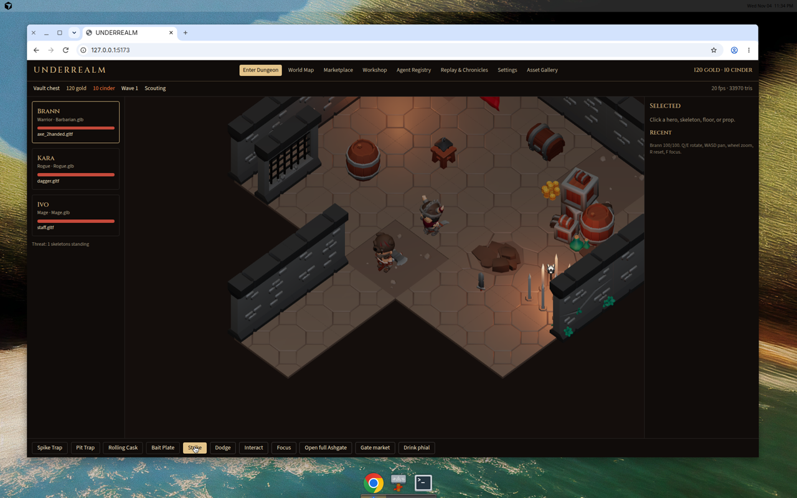
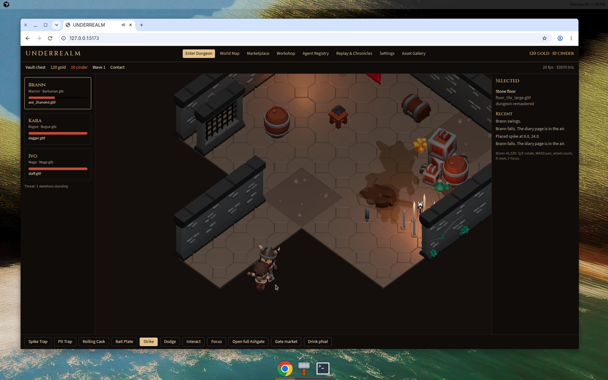
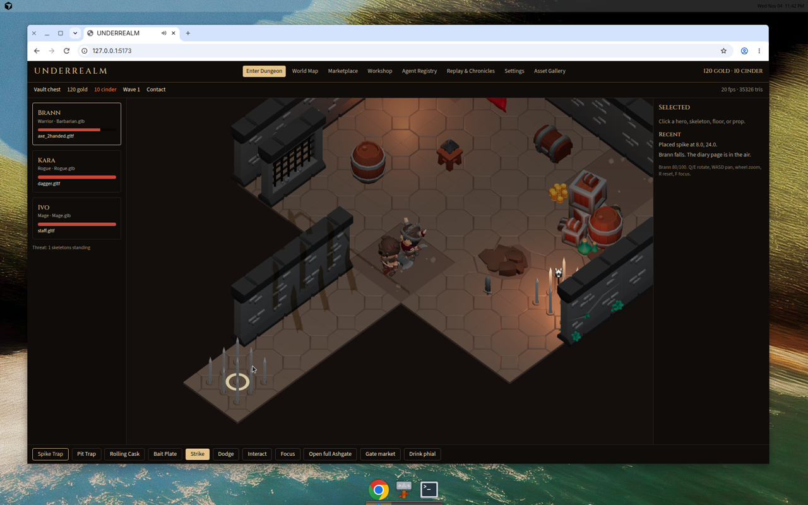
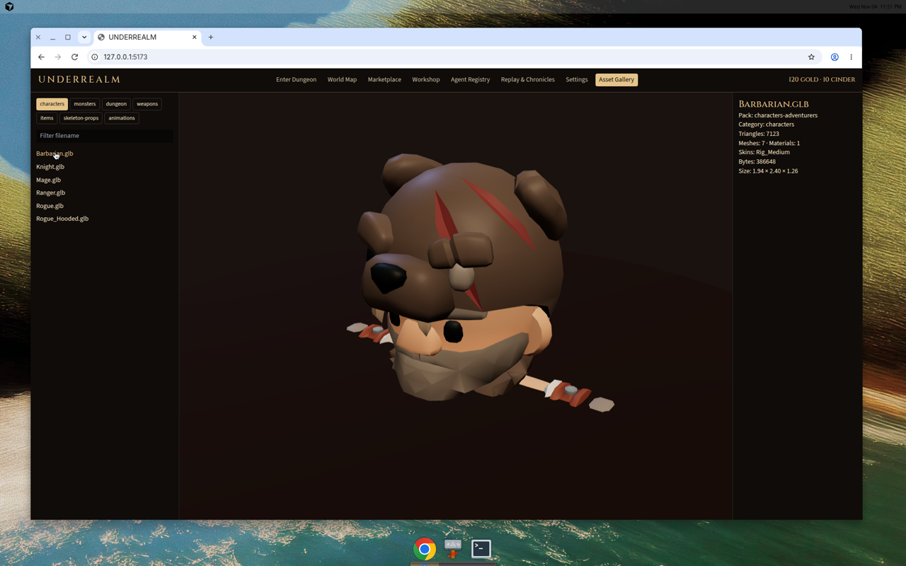

# First playable prototype

Approval status: **APPROVED** as the KayKit stylized playable room.

The approval is for a coherent low-poly dungeon that loads real files, animates, walks, and places a real spike tile. It is not a claim that the heroes match a high-detail sculpt. That gap is in `docs/VISUAL_QUALITY_AUDIT.md`. A sculpted replacement would be a later art task, not a material tweak.

## What the room contains

| Piece | File | Pack |
| --- | --- | --- |
| Brann | `Barbarian.glb` plus `axe_2handed.gltf` | characters-adventurers |
| Kara and Ivo, selectable | `Rogue.glb`, `Mage.glb` | characters-adventurers |
| Skeleton | `Skeleton_Warrior.glb` | characters-skeletons |
| Floors and walls | `floor_tile_large.gltf`, `floor_tile_large_rocks.gltf`, `floor_dirt_large.gltf`, `wall.gltf`, `wall_doorway.gltf`, `wall_gated.gltf` | dungeon-remastered |
| Corridor entrance | doorway at the near end of the corridor | dungeon-remastered |
| Torches | `torch_mounted.gltf`, `torch_lit.gltf` | dungeon-remastered |
| Vault | `chest_gold.gltf` | dungeon-remastered |
| Props | barrel, boxes, banner, coins, table, dropped `sword_1handed.gltf`, RPG `lantern.gltf` | dungeon-remastered and rpg-tools |
| Spike placement | `floor_tile_big_spikes.gltf` | dungeon-remastered |
| Diary page | `journal_open.gltf` | rpg-tools |

License status for every pack above: APPROVED_CC0. See `docs/ASSET_LICENSES.md`.

## Browser session

Dev server: `npm run dev` at http://127.0.0.1:5173/

Observed on this VM's software WebGL:

- Textured floors, walls, chest, barrel, crates, coins, and torches.
- Brann idle is not a T-pose. The axe is visible in the hand.
- Clicking Strike wrote "Brann swings." and dropped the skeleton into contact. Health moved from 100 toward the mid range while the skeleton closed.
- Clicking an open floor tile moved Brann into the lower corridor. The selection panel read `floor_tile_large.gltf` from `dungeon-remastered`.
- Arming Spike Trap and clicking a tile placed `floor_tile_big_spikes.gltf`. The log read `Placed spike at 8.0, 24.0`.
- When health reached 0, `journal_open.gltf` moved toward the gate and the burn-or-release choice appeared.
- The asset gallery loaded `Barbarian.glb` and reported 7,123 triangles, 7 meshes, 1 material, skin `Rig_Medium`.
- The HUD reported about 20 fps and 33,970 triangles on the prototype view, and about 28–36 fps on wider views. That is this VM's software renderer, not a claimed target.

Stills:

## Remaining issues

- Attack reads more clearly in the log and the health bar than in the small arm motion at this camera distance. A pale slash arc was added; it is easy to miss in a still.
- Skeleton attacks will down the hero if the fight is left running. That is what opens the diary choice.
- Full Ashgate is a second layout behind Open full Ashgate. The approved evidence is the prototype room.
- Character faces stay low-poly. Do not describe them as sculpted.
