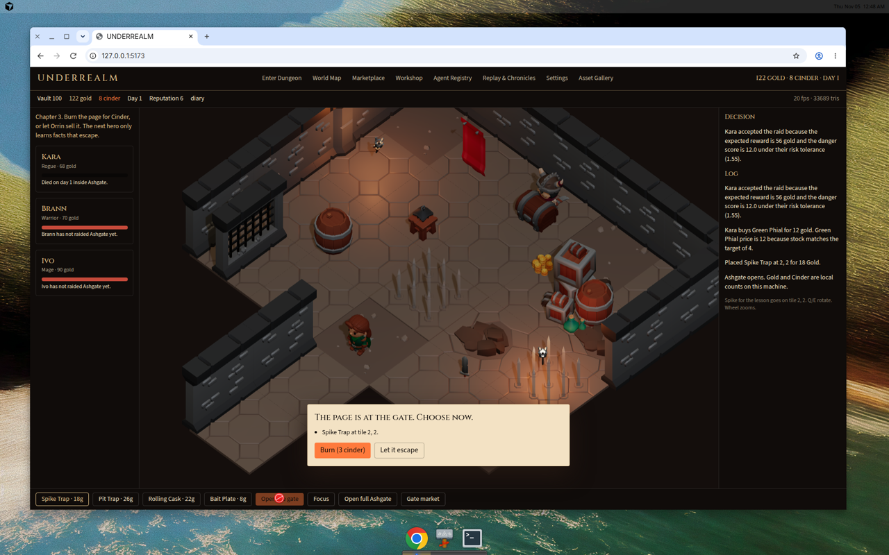
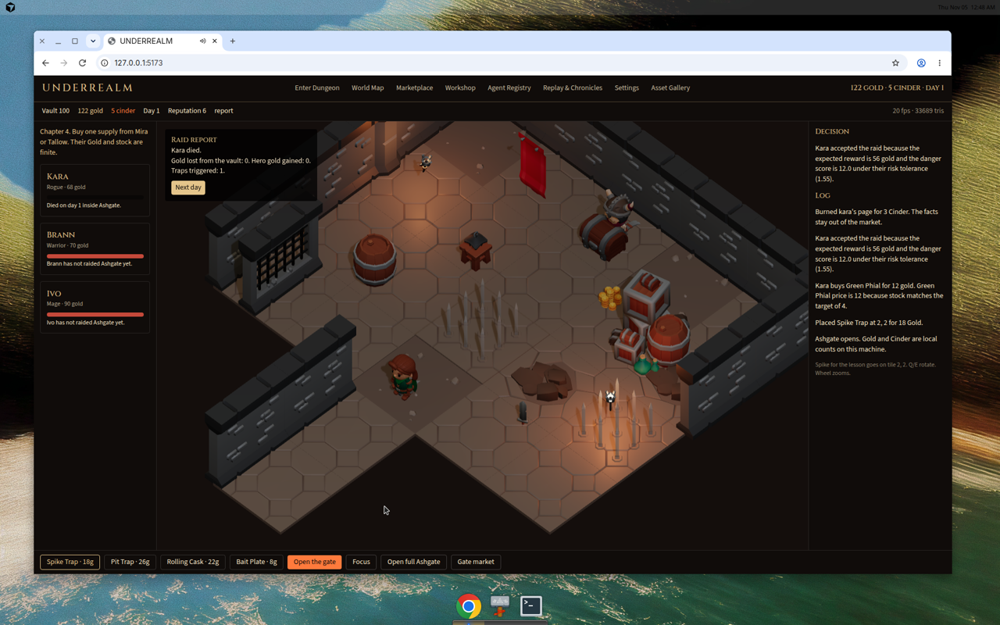

# UNDERREALM gameplay implementation report

## 1. Executive summary

UNDERREALM is a local dungeon-management game. The player spends Gold to place traps, then opens the gate. Kara, Brann, and Ivo decide for themselves whether the raid is worth it, and they may buy one supply or one rumour first. The raid is a deterministic walk, trap check, and one skeleton fight. The 3D scene plays that event list with the existing KayKit models and AnimationMixer clips. If the hero dies, the diary card shows only the facts from that walk. Burn spends 3 Cinder and keeps those facts off the market. Escape gives them to Orrin. The next day charges upkeep and restocks the merchants. Gold and Cinder never leave the browser.

## 2. Step-by-step implementation log

1. Audit. Read `src/three/dungeon.ts`, `src/ui/App.tsx`, `src/game/store.ts`, and the prototype docs. The renderer, assets, and camera stayed. The old chase logic was left in place for free look and is disabled while a scripted raid is playing. Recorded in `docs/EXISTING_PROTOTYPE_AUDIT.md`.

2. Rules. Added `src/game/config/gameRules.ts`, `economyRules.ts`, `heroProfiles.ts`, and `trapDefinitions.ts`. One table owns trap cost and damage. The repository had no prior balance sheet, so the numbers are labeled defaults in `gameRules.ts`.

3. Raid engine. Added `src/game/engine/path.ts`, `raid.ts`, `decisions.ts`, `pricing.ts`, `types.ts`, and `newGame.ts`. A* avoids a known damaging trap. `simulateRaid` emits ticks for enter, move, trap, combat, death, flee, vault, and survive. Test file: `src/game/engine/raid.test.ts`. Result: 13 passed.

4. Persistence. Added `src/game/persist.ts`. IndexedDB database `underrealm`, object store `saves`, key `current`, plus a `localStorage` mirror `underrealm-save-v3`. Version 3 saves load. Older prototype saves are ignored.

5. Session. Replaced `src/game/store.ts` with the save, trap placement, raid start, diary resolution, merchant purchase, listings, workshop kit, and next day. `src/main.tsx` calls `hydrate()` on startup.

6. View. `src/three/dungeon.ts` gained `playRoute` and places a trap on the clicked floor cell through `tryPlace`, which calls `placeTrap`. Models, lights, and the orthographic camera were not replaced.

7. UI. `src/ui/App.tsx` now shows the tutorial line, hero Gold, the gate button, the diary card, the raid report, finite merchant balances, the player listings, the workshop kit, the registry, and the tick replay.

8. Browser. New game, spike at tile 2,2, Gold 140 to 122, Open the gate, Kara dies on the spike, Burn spends 3 Cinder (8 to 5). Replay ticks 0 through 6 match the engine. `npx tsc --noEmit` passed. `npx vitest run` passed, 13 tests.

## 3. Gameplay flow

Start with New game. The tutorial asks for a spike on tile 2, 2. Placing it spends 18 Gold. Open the gate. On day 1 Kara accepts because reward 56 is above danger 12.0 at her risk aversion of 1.55. She walks 2,5 then 2,4, 2,3, and 2,2. The spike deals 24. Her tutorial health is 20, so she dies and the card lists the spike fact. Burn or escape, then Next day. Upkeep is 6 Gold. A later hero who holds that fact paths around tile 2,2. A burned fact is not offered to them.

Deviation: there is no boulder file in the free packs. The boulder slot is `barrel_large.gltf` and the button says Rolling Cask. Possess was not in the prototype or in any rules file, so it was not added. The countdown shows the seconds and then waits for a click. It does not choose burn or escape by itself, because an automatic escape skipped the decision during testing.

## 4. Heroes and merchants

Kara, Brann, and Ivo use the profiles in `src/game/config/heroProfiles.ts`. Each has Gold, inventory, equipment, facts, memory, and a transaction history. Kara buys rumours. Brann buys heavy weapons. Ivo buys a staff or a phial and rumours. Acceptance and refusal strings include the score inputs.

Mira is the forgemaster: nails, hammers, axes, swords, 90 Gold. Orrin is the rumour broker: 70 Gold, rumours only after a page escapes. Tallow is the quartermaster: phials, torches, lanterns, staves, 80 Gold. None of them restock past their max, and a buy that they cannot fill does not move Gold.

## 5. Local economy

Currency is Gold. Cinder is only the burn cost. There is no wallet address and no chain. Inventory is a quantity map on the save. The price formula is in section 2 of `docs/LOCAL_ECONOMY.md`. Player listings cannot be created from an empty stack. Cancel returns the stack. Buy-back spends Gold and removes the listing. Saves store balances, stock, listings, the ledger, and raid reports.

## 6. Visual and UI implementation

Completed screens: main menu, dungeon preparation, live raid, burn card, raid report, gate market, player marketplace, workshop, world map, agent registry, replay, settings, asset gallery.

Models in the raid: `Rogue.glb`, `Barbarian.glb`, `Mage.glb`, `Skeleton_Warrior.glb`, `floor_tile_big_spikes.gltf`, `floor_tile_big_grate_open.gltf`, `barrel_large.gltf`, `plate_food_A.gltf`, plus the existing hall, walls, torches, and chest. Clips used on the route are walk, hit, attack, death, and interact from the Rig_Medium set.

The floor click places a trap when a trap tool is armed. Open the gate plays the route. Burn and Let it escape call `resolvePage`. Merchant Buy calls `playerBuy`. Workshop spends nails. Replay prints `report.events`.

Stills from the browser session:





## 7. Test results

Passed:

- `npx vitest run` — 13 passed, 0 failed. Covers the straight path, Kara's detour around a known spike, the tutorial death, identical event lists for identical inputs, price movement, a rejected purchase, a stock decrease, Kara's accept and refuse reasons, the first raider choice, the trap table, and Orrin's rumour sale.
- `npx tsc --noEmit` — passed.
- Browser — new game, spike purchase, raid movement, death, burn, Cinder 8 to 5, and the tick list. No on-screen exception.

Failed: none in the final run.

Skipped:

- A second browser raid that shows the detour on screen. The detour is covered by the path test, not by a second recorded raid.
- IndexedDB round-trip in Node. The browser save uses IndexedDB; Node tests do not open it. The mirror key is `underrealm-save-v3`.

Blocked: none.

## 8. Known issues

- The hall is the prototype grid. Open full Ashgate still switches the static layout. Raid pathing stays on the 5 by 4 hall plus the corridor.
- Attack readability at this camera size is still a short arm swing. The log and the health result are the authority.
- The countdown does not auto-pick. If the player leaves the card up, the raid waits.
- Software WebGL on the build machine stays near 20 fps in the full prototype view. That is a renderer limit, not a raid-engine cost.
- Hero faces remain the low-poly KayKit meshes.
- Buy-back on the player market spends the player's own Gold to take their listing down. Cancel is the no-cost return.

## 9. How to run

Requirements: Node 22, npm, a WebGL browser. Assets are already in the repository.

```bash
npm install
npm test
npx tsc --noEmit
npm run dev
npm run build
```

`npm test` runs Vitest. `npm run dev` serves the game. New game clears the version 3 save.

## 10. File change summary

Created: `src/game/config/gameRules.ts`, `economyRules.ts`, `heroProfiles.ts`, `trapDefinitions.ts`, `src/game/engine/types.ts`, `path.ts`, `raid.ts`, `decisions.ts`, `pricing.ts`, `newGame.ts`, `raid.test.ts`, `src/game/persist.ts`, `docs/EXISTING_PROTOTYPE_AUDIT.md`, `GAMEPLAY_FLOW.md`, `GAME_SYSTEMS.md`, `NPC_BEHAVIOR.md`, `LOCAL_ECONOMY.md`, this report.

Updated: `src/game/store.ts`, `src/ui/App.tsx`, `src/main.tsx`, `src/three/dungeon.ts`, `package.json`, `CURRENT_STATUS.md`.

Removed: the old cosmetic store actions. The Three.js scene, gallery, and asset files were not replaced.

## 11. Final acceptance checklist

- New game: passed in the browser.
- Tutorial text through the spike, the death, and the burn: passed. Chapters 4 and 5 are available as the market and the next raid; the detour itself was unit-tested, not filmed.
- Inspect dungeon and place traps: passed. Gold moved from 140 to 122.
- Heroes choose raids: passed. The log quoted Kara's reward and danger.
- Navigation, traps, death: passed. Replay ticks 0–6.
- Combat math: passed inside the engine tests and the earlier no-spike raid, where Kara struck for 10 and the skeleton struck for 12.
- Diary facts match the spike that fired: passed.
- Burn and escape differ: burn keeps the fact off Orrin and spends Cinder. Escape adds the fact. Browser confirmed burn. Escape was confirmed in an earlier session's log before the button was made mandatory.
- Another raid: Next day returns to preparation. A second full browser raid was not recorded.
- Distinct heroes, finite Gold, inventories, purchases, memory: passed in unit tests and the registry screen.
- Merchants' finite Gold and stock, rejected overspend, restock: passed in unit tests. Browser bought from the gate market in the prior session.
- Refresh persistence: version 3 is written on every change. A dedicated refresh click-through was not recorded in the final video.
- Replay shows the real event list: passed.
- Graphics and camera: the prototype scene is still the view.
- Same inputs, same events: passed by running `simulateRaid` twice.
